# The site's own pictures of djmanzo

Screenshots of the running application taken for the website, kept here
because djmanzo's own folder (`app/docs/screenshots/`) does not carry them.
They follow that folder's rules: made with the application's
`scripts/screenshots/` (run from `app/`), named
`<screen>--<theme>[--<skin>].png`, and described below, one row each, in the
same table shape. `npm run shots` reads both folders.

## Screens

| Picture | What it shows | Theme |
|---|---|---|
| [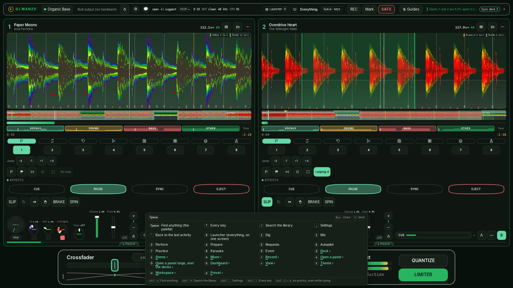](screens/keys--organic-base.png) | Space: the guide to every key, sequences that read as words | Organic Base |
| [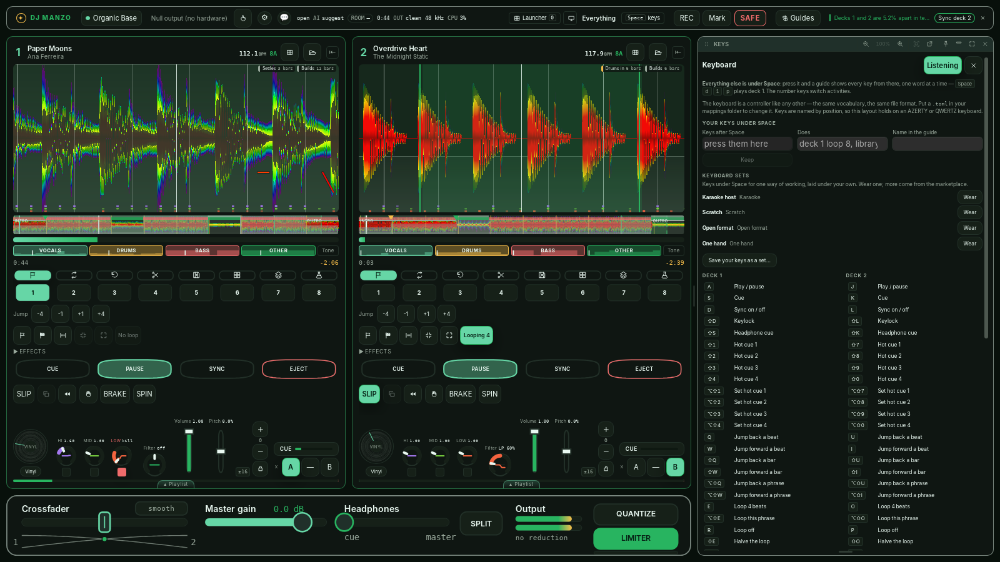](screens/mykeys--organic-base.png) | Keys: your own keys under Space, the four keyboard sets to wear, the keyboard map | Organic Base |
| [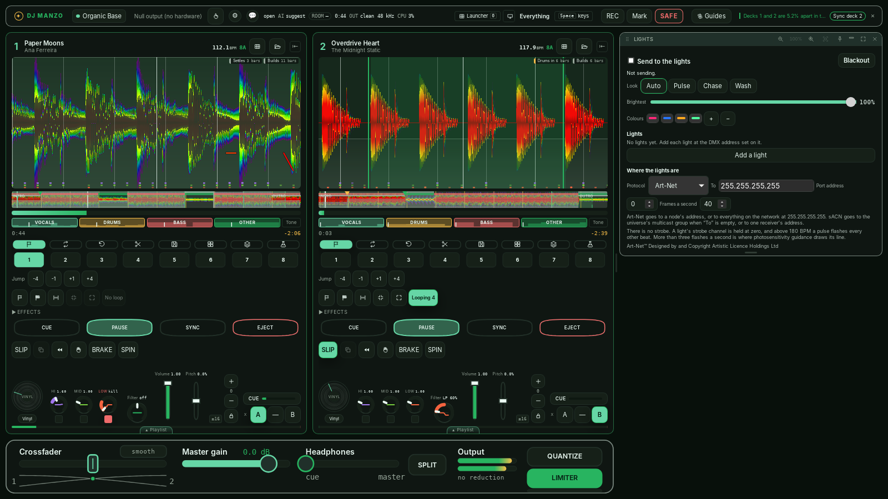](screens/lighting--organic-base.png) | Lights: the room's lights over Art-Net or sACN, following the music | Organic Base |
| [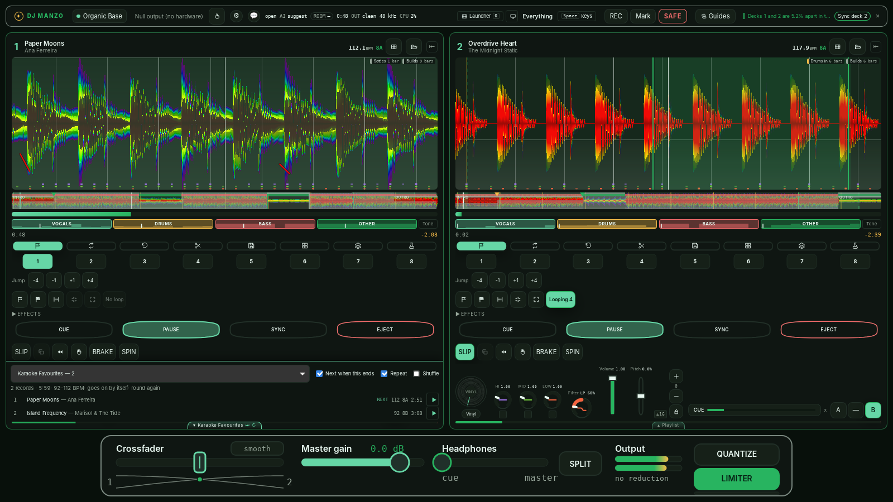](screens/playlist--organic-base.png) | A playlist under the deck: Karaoke Favourites, going on by itself, round again | Organic Base |

## Themes

| Picture | What it shows | Theme |
|---|---|---|
| [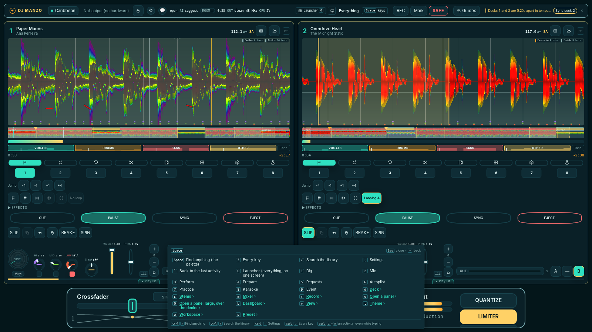](themes/keys--caribbean.png) | Space: the guide to every key, sequences that read as words | Caribbean |
| [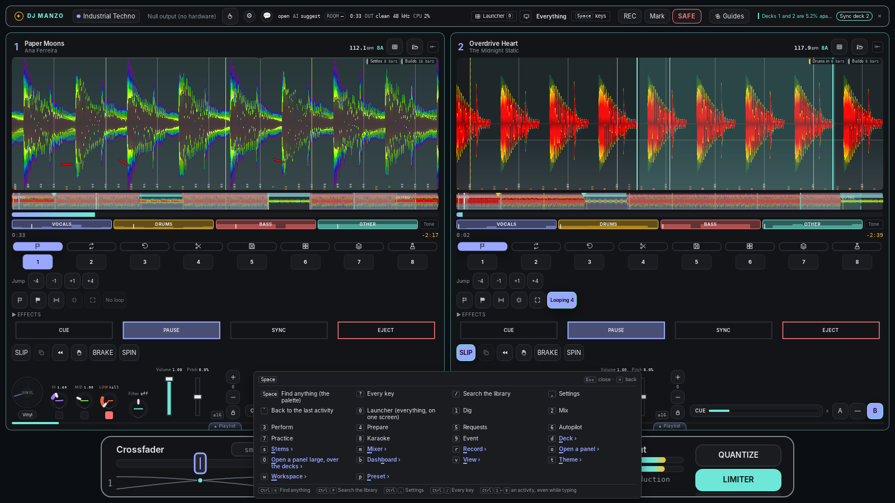](themes/keys--industrial-techno.png) | Space: the guide to every key, sequences that read as words | Industrial Techno |
| [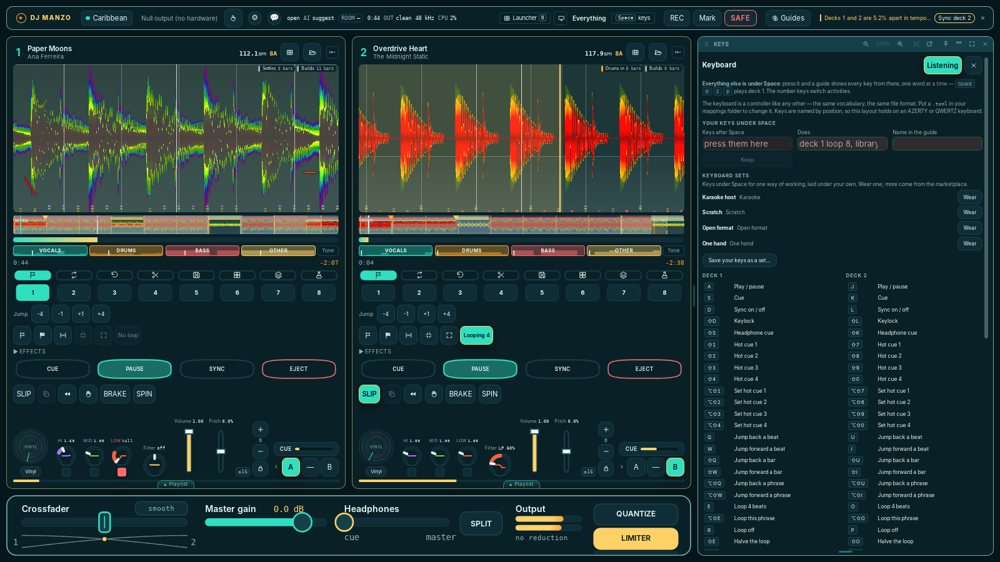](themes/mykeys--caribbean.png) | Keys: your own keys under Space, the four keyboard sets to wear, the keyboard map | Caribbean |
| [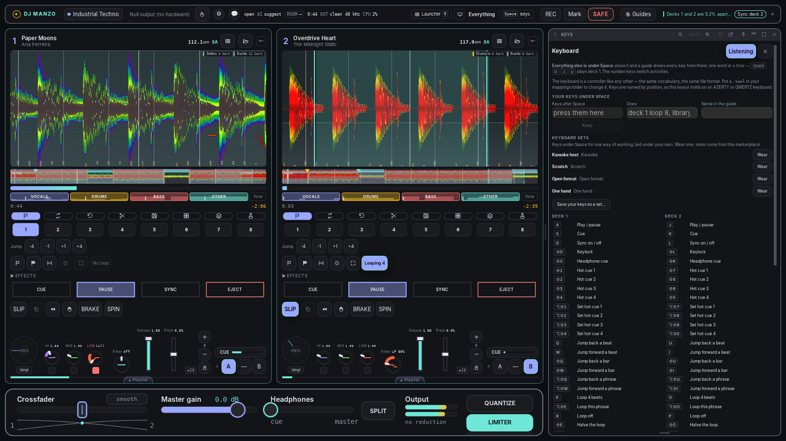](themes/mykeys--industrial-techno.png) | Keys: your own keys under Space, the four keyboard sets to wear, the keyboard map | Industrial Techno |
| [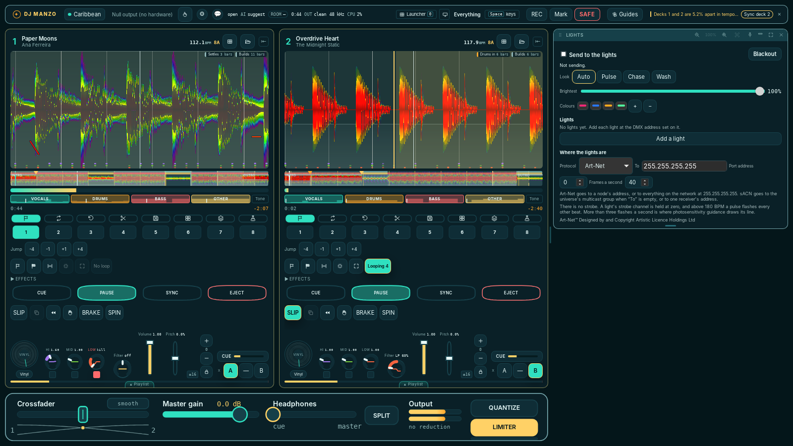](themes/lighting--caribbean.png) | Lights: the room's lights over Art-Net or sACN, following the music | Caribbean |
| [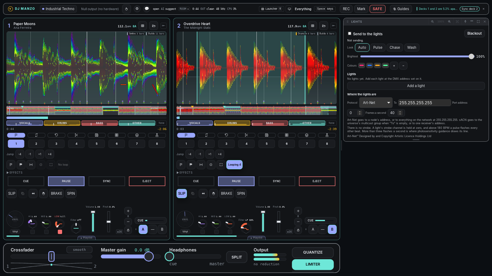](themes/lighting--industrial-techno.png) | Lights: the room's lights over Art-Net or sACN, following the music | Industrial Techno |
| [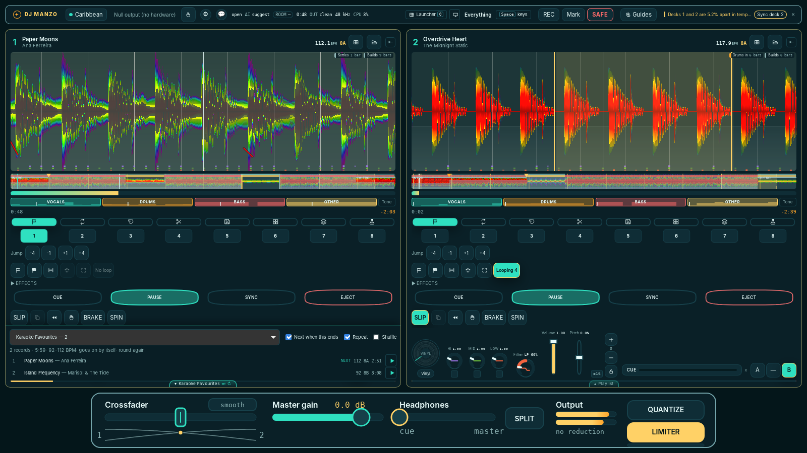](themes/playlist--caribbean.png) | A playlist under the deck: Karaoke Favourites, going on by itself, round again | Caribbean |
