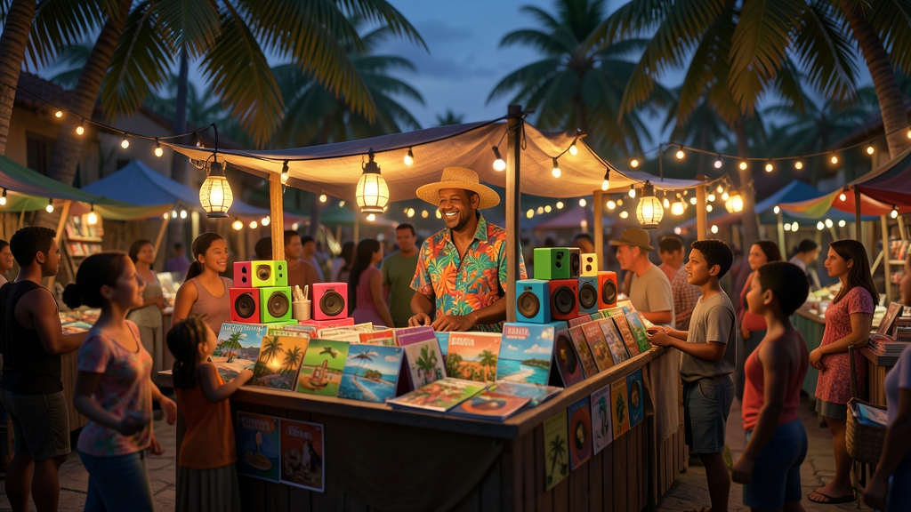
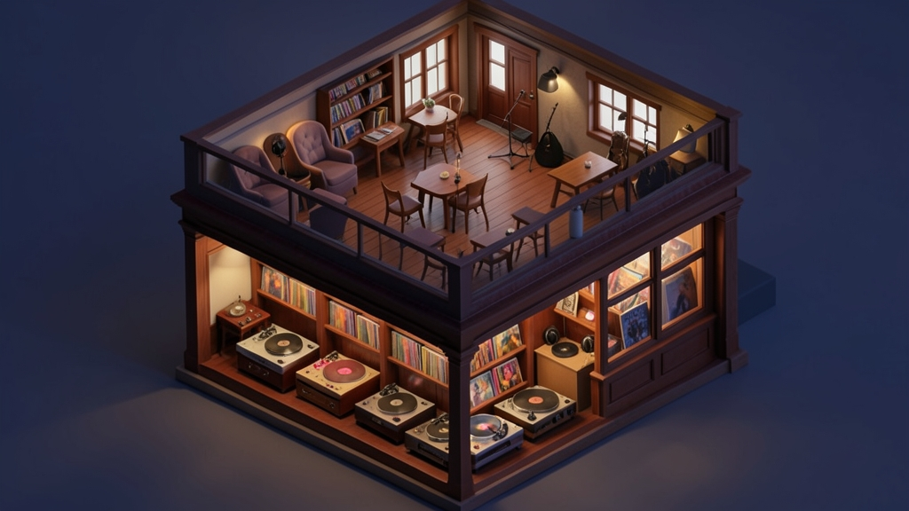
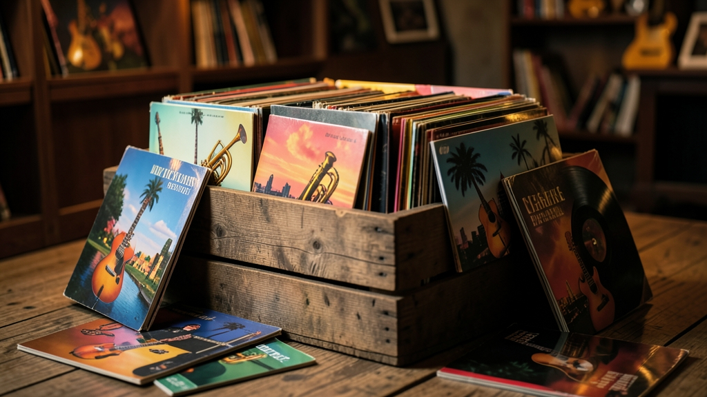
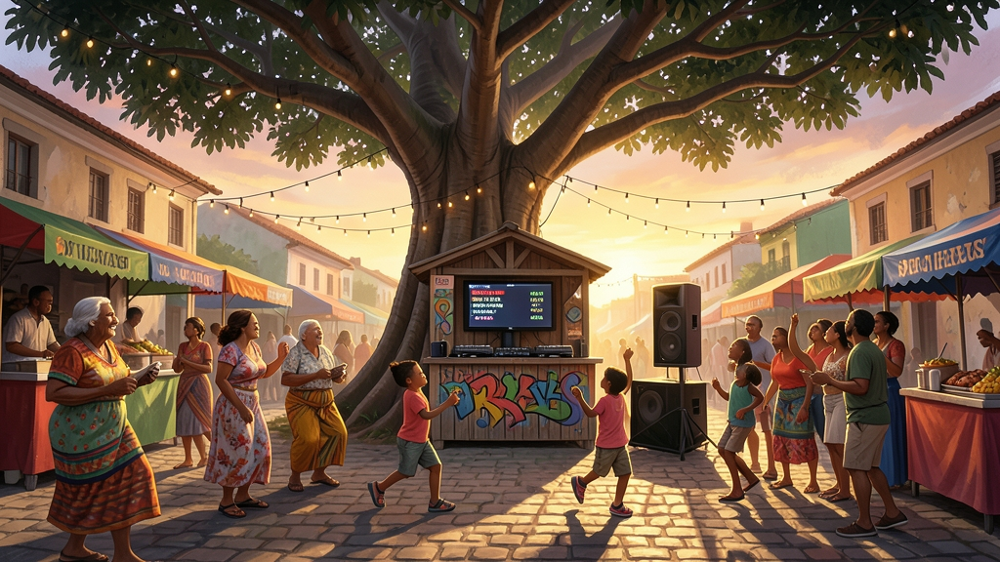
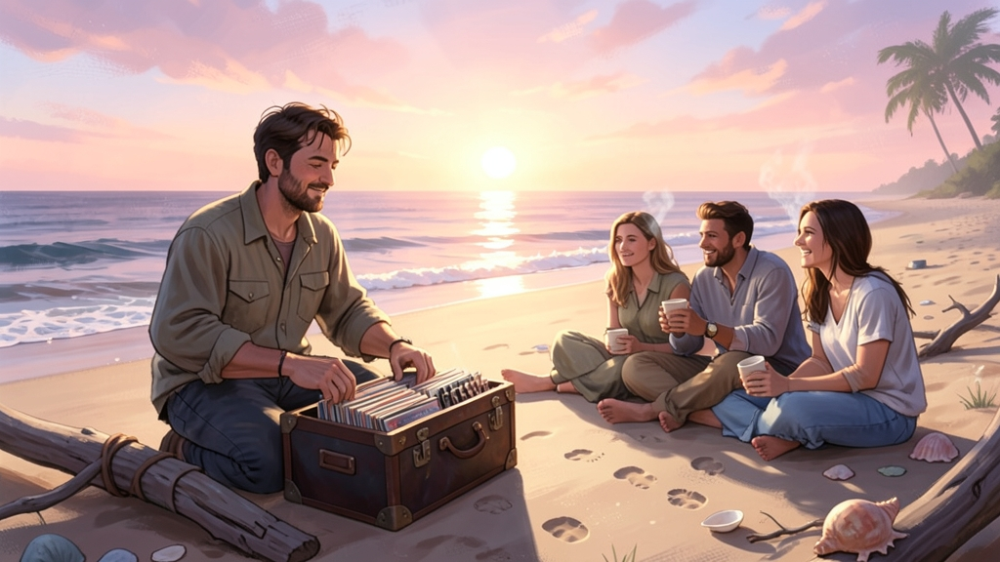
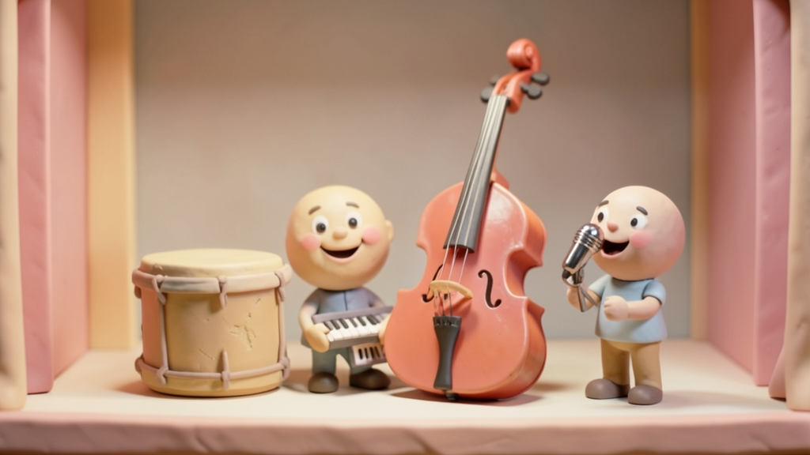
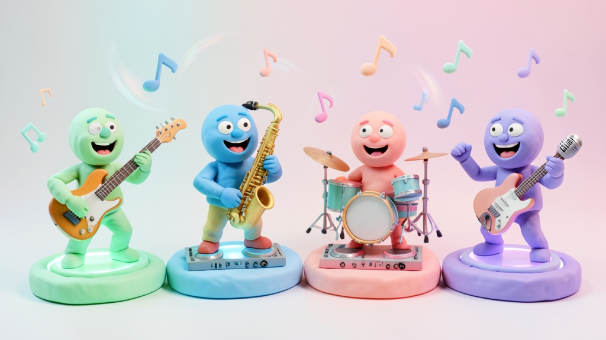
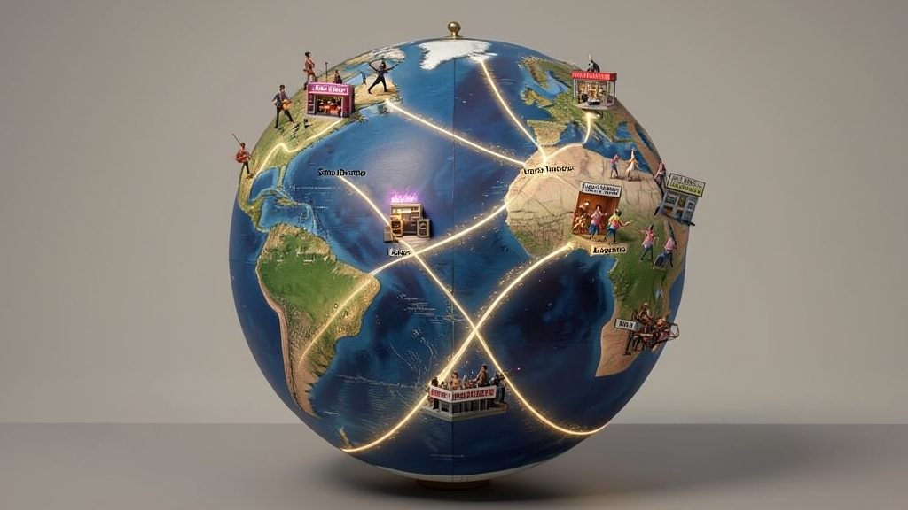
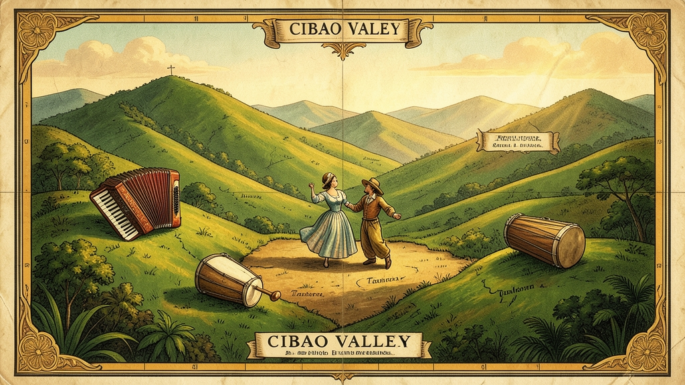

# djmanzo website, version 3: five dreams to choose from

*No code and no architecture yet: five complete ideas, each with its
journey, guide, places, lessons, look, motion, sound and words, so you can
pick one or ask for a mix. They rest on the research report*
`v3-concepts/research/djmanzo website v3 intel.md`, *on what versions 1 and 2 taught
us, and on* `desired_sounds.md` *for the music.*

All pictures here are **AI-drafted samples** (FLUX.2 [klein] 4B on
Cloudflare Workers AI, Apache-2.0, free tier), made to show a mood, not
final art. Their weaknesses are noted where they matter. The example lines
show a voice; any fact in them (a genre's history, an instrument's origin)
is checked against a source before it goes on the site.

---

## What versions 1 and 2 taught us

| | Version 1: Isla Manzo | Version 2: the Signal Path |
|---|---|---|
| Liked | Stations on an island instead of pages | The idea of a guided journey; the painting |
| Not liked | Flat, comic-like; information in side windows | Medium pictures; wasted space; overlays; superfluous steps; weak witty lines; abstract |
| Lesson | Places beat pages | Abstraction hides the product; every step must pay for itself |

**The research adds these rules** (sources in the report):

1. **One small world you can finish**, where each place has **one verb**
   (play, sing, dig, ask). *Messenger*, *Igloo Inc.* and Bruno Simon's
   island all work this way.
2. **The visitor can't make a bad sound.** Toys snap to the beat and the
   key, so the first touch always sounds good (Blob Opera, Incredibox).
3. **Sound guides, not arrows or pop-ups.** Music leaks from where things
   are, so you walk towards it.
4. **One question, then the route changes.** "DJ, karaoke host, or just
   curious?" — and never again uninvited. That beat mascots and long
   onboarding in the studies found.
5. **A plain path is always one tap away.** Shop, download, forum and
   wishlist all have ordinary pages that never pass through the spectacle.
   The worst-reviewed immersive sites lacked exactly this.
6. **Nothing over the world.** Panels are surfaces *in* the world (a sign,
   a sleeve, a menu board), never overlays dimming it.
7. **The open ground is teaching.** Nobody has made playable web lessons
   for the Camelot wheel, beatmatching by ear, phrasing or the EQ bass
   swap. djmanzo can own that.
8. **Honest offers only.** EU law already bans fake countdowns and requires
   the 30-day lowest price beside a discount; the honest version is also
   the nicer one.

**Design read:** a marketing and community home for a DJ and karaoke desktop
application · DJs from first gig to wedding pro, karaoke hosts, curious
music lovers, strongly Latin and Caribbean, also European · playful, warm,
meaningful, wholesome · 3D game-world family, never "gaming aggression"
(neon, lasers, festival excess).

**Dials:** Creativity = Bold · Density = Balanced (no more empty space) ·
Variance = Playful · Motion = Kinetic, with a calm static path when the
visitor prefers reduced motion. Accessibility and EU consumer law override
any of these when they conflict.

**Maturity:** L0 by the design-system rule (no `DESIGN.md`).
`docs/WEBSITE-ART.md` stays a reference, not a constraint, since you asked
for a fresh direction.

---

## The five dreams at a glance

| | Dream | One line | Distinct style family |
|---|---|---|---|
| 1 | **La Isla del Disco** | A small island shaped like a record; you walk its grooves | Painterly 3D diorama, golden hour |
| 2 | **The Record Shop at the End of the Street** | A three-floor music shop; you dig crates and every sleeve opens a world | Warm cinematic interior, tactile, cut-away |
| 3 | **One Night in Your Town** | One evening from soundcheck to sunrise, in the visitor's own town and weather; the crossfader is time | Cinematic illustrated film |
| 4 | **The Band in Your Hands** | A cast of clay characters who *are* the sounds; you build a mix by dragging them | Soft 3D toy / clay, Incredibox-like |
| 5 | **The Atlas of Sound** | A painted globe of genres, places and lineages; you travel where music comes from | Hand-painted atlas, cartographic |

---

## Dream 1 — La Isla del Disco

**Theme statement:** *warm, playful, island.*

**The idea.** One small Caribbean island seen from just above, shaped like a
vinyl record. Its grooves are terraced paths, the tonearm is a lighthouse,
and its sweep is the day passing. You can walk round all of it in two
minutes, and every place has one thing to do. This is version 1's best idea
(stations, not pages), now as a real 3D world, small and finished.

**The first 30 seconds.**
1. A still painting of the island is already there while the rest loads,
   with a progress groove spinning around its edge.
2. One line: *"Every record has two sides. Let's play the good one."* One
   question as three wooden signposts on the jetty: **I DJ · I host karaoke ·
   I'm just curious.**
3. The answer sets your path and your music (house, Latin, party). The
   lighthouse turns and its beam lands on your first place. You drift there
   on a motoconcho (a moto-taxi) or a little boat. No intro film and no
   modal.

**The guide.** **Doña Clave**, the island's music teacher, a woman in her
sixties with a güira in her apron. She appears only *in* places, never
over them. One line each time, then she stops talking. Her words come from
the AI (Workers AI, free) inside a scripted frame, so the voice stays
hers.

**Places, one verb each.**

| Place | Verb | What you touch | What it teaches or shows |
|---|---|---|---|
| The jetty | **Choose** | The three signposts | Your path |
| The record grooves (terraces) | **Walk** | The path itself is a waveform; walking scrubs the song | Beat grid, phrases (each terrace is 8 bars) |
| The booth under the ceiba tree | **Mix** | Two decks, beat-locked; drag the crossfader | Transitions; sync and keylock; it can't sound bad |
| The lighthouse | **Turn** | Its lens is the Camelot wheel; turn it and two songs blend or clash | Harmonic mixing, 8A next to 9A |
| The karaoke porch | **Sing** | A song with its vocals pulled out by stems; the microphone optional | Karaoke, stems, the singers' screen |
| The mercado | **Browse** | Creators' stalls (Outboard): live previews of themes and skins | The marketplace, free, with donation links |
| The plaza | **Talk** | Benches where conversations sit (Talkback) | The forum, in its own plain page |
| The message-in-a-bottle beach | **Wish** | Bottles washed ashore, each a feature request with its status | The wishlist; "you asked, we built" bottles glow |
| The fiesta ground | **Celebrate** | A seasonal fair (Christmas, summer, launch week) | Honest special offers |
| The ticket booth at the harbor | **Leave with it** | The editions as boat tickets; the free one is the ferry | Download, editions, the 7-day trial |

**Real life.** The island is anyone's town: the colmado with its speaker,
the wedding under the tree, the grandmother dancing. The places name real
skills (a "wedding set" lesson, a "first gig" path), real values (the
fiesta ends in time), and real scenes (the plaza's notice board lists real
community events the crew adds).

**Look.** A painterly 3D diorama in golden hour: the existing painter pass
stays, with better meshes and generated textures. Palette: turquoise sea,
coral, mango gold, deep blue night.

**Motion.** Camera flights baked in Blender and scrubbed by GSAP; the
island's day slowly turns with the music. Characters (Quaternius, CC0)
dance in time with the bed.

**Sound.** Each place leaks its bed (desired sounds D1–D9); the closer you
are, the louder. Latin path: B2, B3, B4, B5; house path: A1, B12.

**Words, an example.**
- *"Every record has two sides. Let's play the good one."*
- At the lighthouse: *"8A and 9A are neighbours. 8A and 3B have never met.
  Turn the lens and hear why."*
- At the karaoke porch: *"Nobody remembers who sang in tune. Everybody
  remembers who sang."*

**Strengths:** the warmest; the most direct line to *Messenger* and Bruno
Simon; fits a Bávaro-based brand perfectly. **Risks:** it can read as "the
island again"; it must be visibly 3D and alive, not version 1 redrawn.
**Effort:** high (a whole small world, ten places).

---

## Dream 2 — The Record Shop at the End of the Street

*(The crate picture has invented "text" on the sleeves; final art would put
real titles in the page, not in the image.)*

**Theme statement:** *tactile, generous, neighbourhood shop.*

**The idea.** A three-floor music shop at dusk, cut open like a dollhouse.
The camera glides between rooms, and the whole screen is always full of
things to touch: no wasted space. The one big verb is **digging**: you flip
through crates, and each sleeve is a genre, a lesson, a feature, a creator's
pack or a song. Pull a sleeve and it plays, and its back cover tells you
what it is.

**The first 30 seconds.**
1. The shop window at dusk, lights on; through the glass you see people and
   a turning record. The doorbell chimes when you tap.
2. **Don Ramón** behind the counter (the owner): *"Looking for something,
   or just looking?"* — **Looking for: DJ software · Karaoke · Just
   looking.**
3. He hands you a crate already sorted for your answer. You are digging
   within ten seconds.

**Places.**

| Room | Verb | What happens |
|---|---|---|
| The front crates | **Dig** | Flip sleeves (GSAP Flip and Inertia): every genre has a sleeve; pulling it plays its song and shows its lineage |
| The listening booths | **Listen and mix** | Put two records on the booth's decks; the beat and key lock; learn the crossfade by doing it |
| The back counter | **Ask** | Don Ramón answers questions (the AI guide) with real facts; *"I don't know"* when he doesn't |
| The karaoke room (a tiny private booth) | **Sing** | A private room, as in Japanese solo karaoke: low pressure, your voice only for you |
| The basement practice room | **Practise** | The lessons: Camelot, beatmatching by ear, phrasing, EQ, stems; a skill tree on the wall (no streaks) |
| The mezzanine of sleeves made by customers | **Browse** | Outboard: creators' packs as sleeves; a plain grid behind it |
| The café corner | **Talk** | Talkback's newest threads on the café chalkboard; the forum on its own page |
| The suggestion box | **Wish** | The wishlist, with honest statuses |
| The shop window | **Celebrate** | The season's honest offers; the window changes for Christmas, summer, a launch |
| The till | **Take it home** | Editions as records you take home; the free one is "the single" |

**Real life.** Everyone knows a record shop, or a colmado where music was
always on. The shop gives the site an honest, human voice: a shopkeeper
knows the music, recommends kindly and tells you when you don't need the
expensive one.

**Look.** Warm cinematic interior: wood, lamp light, paper sleeves, dust in
the light. 3D rooms, with sleeves as high-quality generated paintings (one
style trained for all of them).

**Motion.** Camera glides between rooms (Blender-baked, GSAP-scrubbed); the
sleeves' physics (Inertia); doors, records and needles with real weight.

**Sound.** The shop's own record player plays a bed (D2 in the crates, D3 in
the booths, D4 in the karaoke room); each sleeve plays its genre song.

**Words, an example.**
- Don Ramón: *"Take your time. Records wait; that's what they're good at."*
- On a sleeve's back: *"Bachata: born in the Dominican countryside, once
  called 'bitter music', now danced at every wedding. Pairs well with: 8A,
  slow hands, grandmother."*
- At the till: *"The single is free, for ever. The album is when you need
  more."*

**Strengths:** the densest and most useful screen; the most natural home
for a marketplace (it *is* a shop); easy to make fast (rooms load one at a
time). **Risks:** less "wow" from far away; needs very good interior art.
**Effort:** medium.

---

## Dream 3 — One Night in Your Town

**Theme statement:** *cinematic, kind, one night.*

**The idea.** You live one evening as the DJ of your own town, from
soundcheck at six to sunrise. The site already knows roughly where you are,
your sunset time and your weather (with your consent), so the square is
*your* town's light tonight. The navigation is a **crossfader** at the
bottom of the screen: left is early evening, right is sunrise. Drag it and
time moves: not scrolling hijacked, but a control you own.

**The hours.**

| Time | Scene | Verb | What it teaches or shows |
|---|---|---|---|
| 18:00 | Soundcheck in the square | **Set the levels** | Gain and EQ: push it into the red and hear it clip; pull it back and hear it breathe |
| 19:30 | Families arrive | **Read the room** | Pick music for grandmothers and children; the assistant whispers suggestions |
| 21:00 | The karaoke corner | **Sing** | Stems, the singers' screen, the queue |
| 22:30 | The first peak | **Mix** | Beatmatching, phrasing, harmonic mixing in a real transition |
| 00:30 | When the night could go too far | **Ease off** | Autopilot, and "Freno de Mano": the kind closing set |
| 02:00 | The last song | **Close well** | The last song for everyone, as in B15 |
| 06:00 | Sunrise on the beach | **Take it home** | Download, editions, the trial; the shareable "your night" poster |

**Beside the night** (on a lamp-post menu that is always there):
the Market (Outboard), the Plaza (Talkback), the Wishing Well (wishlist),
the Fair (offers), each a plain page with a small painted scene at the top.

**Real life.** The most real of the five: a real town, a real sunset, the
real arc of a gig. It is also the most honest about the craft: the gig is
work, and the kindest set is the one that ends well.

**Look.** An illustrated film: painted, cinematic frames. Each hour is one
wide, generated painting with 3D depth (parallax layers, characters
animated in Rive). The weather and sky follow the visitor's.

**Motion.** GSAP timelines per hour, driven by the crossfader; the light
crossfades with the music.

**Sound.** The night's own soundtrack in order: D1 → D3 → C4 → B1 → B4 →
B15 → D9 (sunrise). The crossfader really crossfades between them.

**Words, an example.**
- At soundcheck: *"Loud isn't the same as heard. Leave some room."*
- At 00:30: *"The best DJs know when to play the slow one."*
- At sunrise: *"Nobody claps for the packing up. Do it well anyway."*

**Strengths:** the strongest story and emotional arc; teaches the job as it
really is; the crossfader is a memorable navigation. **Risks:** a linear
story can feel long for someone who only wants the shop (the lamp-post menu
must be excellent); seven painted hours need very good art. **Effort:**
medium-high.

---

## Dream 4 — The Band in Your Hands

**Theme statement:** *joyful, tactile, toy stage.*

**The idea.** The site is an instrument first. A small stage holds a cast of
soft clay characters, and each one **is** a sound: Bombo the kick drum,
Bajo the long double bass, Teclita the keys, Mic the singer, Güiro, Horn,
and Eco the delay. Drag a character onto one of four pads and it plays, in
time and in key, so it always sounds good. Within one minute the visitor has
built a mix and understood stems, layering and effects without reading a
word. Then the characters walk you to the rest.

**The first 30 seconds.** No question at all: the stage, four empty pads,
and the line *"Pick someone to play."* The first drag makes a beat. When two
or three characters are playing, the question arrives naturally: *"Nice.
Want to do this for real? DJ · Karaoke · Just playing."*

**Places** (each is a backstage door a character opens):

| Door | Verb | What happens |
|---|---|---|
| The stage | **Play** | The toy: stems as characters; effects as characters that change others (Eco makes Mic echo) |
| The teacher's room | **Learn** | The Camelot wheel as a merry-go-round of characters in keys; beatmatching as two drummers walking in step |
| The karaoke door | **Sing** | Mic steps aside: "your turn" |
| The costume shop | **Dress** | Outboard: creators' themes and skins dress the characters and the stage |
| The green room | **Talk** | Talkback; the characters sit around the threads |
| The request box | **Wish** | The wishlist, as song requests for features |
| The tour bus | **Celebrate** | Seasonal tours: honest offers; a free keepsake costume each season |
| The merch table | **Take it home** | Editions and download; "your first mix" recap to share |

**Real life.** The band *is* the music, and the lessons are the real thing
dressed as play. The real culture comes in through the costumes and songs
(merengue band, swing band, house crew), and through recordings people
make and share.

**Look.** Soft 3D clay and toy (a distinct family from the painterly
versions): pastel, matte, rounded, warm studio light. Characters made in
Blender or Rive, rigged to dance.

**Motion.** Rive state machines for characters (idle, play, cheer), GSAP for
the stage, Rapier physics for throwing a character onto a pad.

**Sound.** The stems of the desired songs become the characters' parts:
split A1, B2 and B9 with djmanzo's own stems and give each character its
part. That is a demo of the product in itself.

**Words, an example.**
- *"Pick someone to play."*
- When two clash: *"Teclita and Horn are in different keys. They're
  polite about it. Turn the wheel."*
- *"Stems: take the song apart without breaking it."*

**Strengths:** the most playful and shareable; teaches stems and mixing by
hand in a minute; works superbly on phones. **Risks:** can feel childish to
working DJs (offer the "pro" route via the first question); characters need
excellent animation. **Effort:** medium (one stage, many characters).

---

## Dream 5 — The Atlas of Sound

*(Map labels in these drafts are invented; final maps carry real names in
the page.)*

**Theme statement:** *curious, rooted, hand-painted atlas.*

**The idea.** A slowly turning, hand-painted globe of music. Glowing rivers
are lineages: from the Cibao valley to Santo Domingo's merengue, from
Chicago's house to Linz's electro swing, from Kingston to dembow, from
Lagos to amapiano. Spin it (as in Radio Garden, where the globe *is* the
dial) and land in a place. Each place is a small painted vignette with its
song (the desired songs), its dance, its rhythm (touch the clave, the
tresillo, the four-on-the-floor), its good parts (family, food, community
events), and what djmanzo does for it.

**The first 30 seconds.** The globe turns to where the visitor is (with
consent; otherwise their language region). *"Music came from somewhere.
Here's yours."* The nearest place glows; one tap lands there.

**Places on the globe and around it.**

| Place | Verb | What happens |
|---|---|---|
| Any genre's place | **Travel** | Its vignette, song, rhythm toy and lineage river |
| The river of a lineage | **Follow** | Ride the river between places: how merengue became bachata's cousin; how house travelled |
| The compass (the Camelot wheel) | **Navigate** | Harmonic mixing as a compass: neighbouring keys are neighbouring directions |
| Your trail | **Remember** | Your journey draws a constellation: your taste poster, to share |
| The harbours | **Talk** | Talkback's communities are harbours by genre and craft |
| The makers' markers | **Browse** | Outboard items pinned where their makers live; a plain grid too |
| The lighthouses | **Wish** | Wishlist items as lighthouses; brighter with more votes |
| Festivals on the map | **Celebrate** | Seasonal offers appear as festivals in their season, honestly dated |
| The home port | **Take it home** | Editions and download |

**Real life.** The deepest connection to real places, people, genres and
history. It also needs the most care: the research warns that genre maps go
stale (both well-known ones stopped updating) and that some histories
(dembow's) need careful credit.

**Look.** A hand-painted antique atlas meeting modern colour; editorial
type; illustrated vignettes per place.

**Motion.** The globe in three.js, rivers as shader lines, GSAP for landing
and travel; vignettes open in place, not as overlays.

**Sound.** Each place plays its song; the river travel crossfades between
them, in key when the keys are neighbours (which the compass explains).

**Words, an example.**
- *"Music came from somewhere. Here's yours."*
- In the Cibao: *"Accordion from Germany, drum from Africa, scraper from
  the Taíno. Merengue is a family reunion."*
- On a river: *"Nobody invents a genre alone."*

**Strengths:** the richest meaning; the strongest SEO (every place a page);
a natural home for music theory and history. **Risks:** the product can
recede behind the culture; history must be researched and sourced for each
place (an ongoing editorial job). **Effort:** high (content more than
code).

---

## Comparing them

Scores out of 5, judged against what you asked for:

| | 1 Isla | 2 Shop | 3 Night | 4 Band | 5 Atlas |
|---|---|---|---|---|---|
| Playful, interactive | 4 | 4 | 3 | **5** | 3 |
| Meaning, values, real life | 4 | 4 | **5** | 3 | **5** |
| Teaches music and DJing | 4 | 4 | **5** | 4 | 4 |
| Uses space well, no overlays | 3 | **5** | 4 | 4 | 3 |
| Few steps to the product | 4 | **5** | 3 | 4 | 3 |
| Home for market, forum, wishlist, offers | 4 | **5** | 3 | 4 | 4 |
| "Wow" from far away | **5** | 3 | 4 | 4 | **5** |
| Performance on a phone | 3 | 4 | 4 | **5** | 3 |
| Effort (5 = least) | 2 | 4 | 3 | 4 | 2 |

## My recommendation: a mix, the Shop as the home

**"The Record Shop at the End of the Street", with a globe in the back
room and a band on the counter.**

- **The Shop (2) is the home:** dense, warm and honest; it is literally a
  shop and a meeting place, so the marketplace, the forum, the wishlist and
  the offers all belong there naturally.
- **The Band (4) is the first touch, on the counter:** a small stage of
  clay characters you can play within ten seconds, the "can't sound bad"
  toy that teaches stems.
- **The Atlas (5) is in the back room:** a painted globe where crate
  digging turns into travelling. Each sleeve's lineage opens its place.
- **One Night (3) becomes the practice room's lesson path:** soundcheck to
  sunrise as the order of the lessons.
- **The Island (1) stays the view through the shop's window:** Bávaro
  outside, the town the shop belongs to.

If you would rather choose one pure dream, I'd choose **2** for
usefulness, or **4** for delight.

---

## What every version-3 dream shares

**Always there:** a small bar with Download · Editions · Market · Forum ·
Wishlist · Sign in, leading to plain pages (the existing Outboard, Talkback
and shop work keeps working). Every place has an address of its own (the
SEO built in version 2 carries over).

**The guide.** One question at the start, one line per place, scripted
voice with AI answers inside it (Workers AI within its free share), and
never an overlay. The wittiness lives in specific, true lines like the
examples above, not generic jokes.

**Teaching that nobody else has** (from the research):
- a Camelot dial you play, to hear which keys blend and which clash;
- a pitch fader you drag until two loops stop galloping (beatmatching by
  ear);
- dropping a mix-in marker on an 8, 16 or 32-bar phrase;
- the EQ bass swap with a live spectrum;
- a stem "un-mix" that turns a song into karaoke;
- a skill tree of real DJ skills (no streaks; gentle progress).

**Honest offers.** Real end dates, the 30-day lowest price beside any
discount, no "only two left". Seasons (Christmas, summer, launch week) bring
a free keepsake (a theme, a skin) to everyone.

**Community.** Creator stalls with live previews, a safety scorecard and
one donation link (Blender Extensions' model); gentle trust levels with a
kind "why can't I do this yet?" (Discourse); wishlist statuses including an
honest "not planned", and a "you asked, we built" wall; a report button on
everything (already built).

**Technology.**
- **Keep** Svelte 5 and three.js with the painter on WebGL; port the
  painter to TSL and move to WebGPU later, once screenshots match.
- **Add GSAP 3.15** (now free, all plugins): ScrollTrigger, Observer,
  SplitText, Flip, Inertia, MorphSVG.
- **Camera flights from Blender**, baked into the models and scrubbed by
  GSAP.
- **Rive** for characters and the guide; **Rapier** where physics matters;
  **Quaternius** (CC0) for dancers.
- **Theatre.js:** you asked for it; the research found it unmaintained in
  public (last release May 2024, its editor AGPL). GSAP timelines plus
  Blender cameras do the same job with less risk. If you still want its
  keyframe editor while authoring, it can be used only as a tool on your
  machine.
- **Performance:** a still image first, a progress groove, a render loop
  that sleeps when nothing moves (already done for the overlays in
  version 2), compressed textures (KTX2) and meshes (meshopt).

**Pictures.** Workers AI's free tier for drafts (about 95 a day with
FLUX.2 [klein] 4B, Apache-2.0, as here), then a style model (LoRA) trained
on Kaggle on an Apache-2.0 base (Z-Image) so that every picture shares one
hand, then Real-ESRGAN (BSD) to upscale. Hunyuan models are out (their
licence excludes the EU), and SUPIR is non-commercial.

**Accounts and tokens needed, asked ahead of time:**
- **Kaggle:** a phone-verified account and its API token (`kaggle.json`),
  for training the style model and generating in bulk.
- **Hugging Face:** an access token (read), stored as a Kaggle secret, to
  download the model weights.
- Cloudflare: already in place (the token this session uses).
- **Suno:** a Pro or Premier month while you download the final songs.

**Sound.** `desired_sounds.md`: 23 songs with words and styles, 9
beds, 8 teaching tracks, and the short sounds to cut from them.

---

## Next step

Pick a dream (or the mix), and tell me what to keep and what to drop. Then
I'll draw the chosen one in detail: the flow of every place, the art bible
with a trained style, the lines for the guide, and a clickable mock-up of
the first minute — before any architecture.
